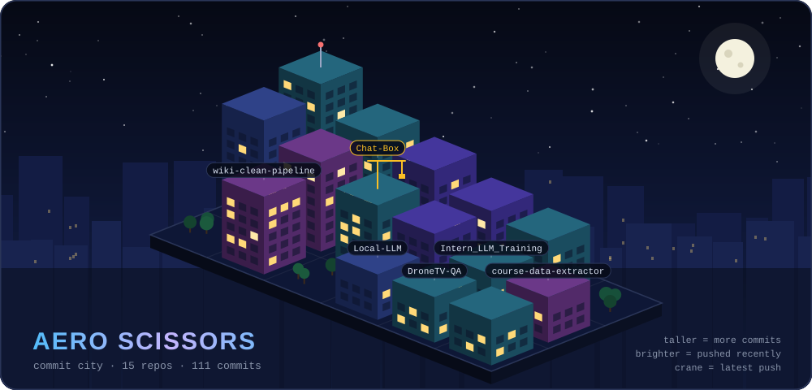

<!-- city.svg and character.svg are redrawn daily from my GitHub data by .github/workflows/profile.yml -->

  

 

  

### 🗺️ Featured quests

  
  
  

| Quest | What it does | Built with |
| --- | --- | --- |
| [**cortexfeed**](https://github.com/AeroScissors/cortexfeed) | Reads your open AI chat, finds the project files that matter and pastes them in as context. Runs locally on Ollama, so your code stays on your machine. | Python · Flask · Chrome extension |
| [**trading-agent-openenv**](https://github.com/AeroScissors/trading-agent-openenv) | Reinforcement-learning environment for multi-asset portfolio agents, scored on Sharpe ratio instead of raw profit. | Python · FastAPI · Docker |
| [**Spam-Detection**](https://github.com/AeroScissors/Spam-Detection) | Detects spam emails and phishing URLs with trained ML models served through an API. | Python · scikit-learn · Flask |

### 👋 About me

- 🛠️ Backend-leaning full-stack developer who also builds ML projects
- 🔭 Currently building: <!-- TODO: your current project, one line -->
- 🌱 Learning: <!-- TODO: what you're studying right now -->
- 💼 Open to work — internships and junior backend / ML roles

<!-- TODO: add contact links you want public, e.g. LinkedIn or your portfolio site -->
